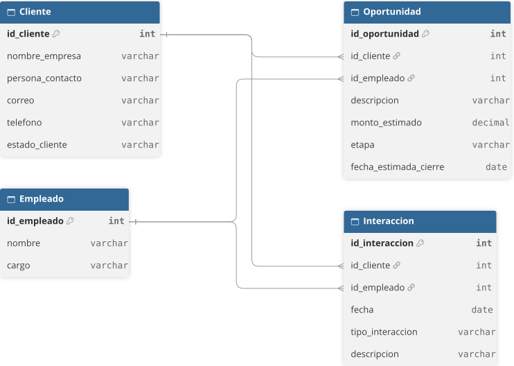

# Modelo Entidad-Relación (MER) — Módulo CRM

**Módulo:**
- CRM (Customer Relationship Management)

**Integrantes:**
- Emilia Catalina Yévenes Figueroa
- Benjamín Alonso Cruces Molina
- Vicente Tomás Corrales Lincoñir
- Vicente Joaquín Arias Cáceres
- Valentina Nicolet Villegas Quintana

---

## 1. Descripción general

El modelo entidad-relación del módulo CRM describe la estructura de datos necesaria para gestionar el ciclo de vida del cliente: sus fichas, las comunicaciones realizadas con cada contacto y las negociaciones en curso. Está compuesto por **cuatro entidades** —**Cliente**, **Empleado**, **Oportunidad** e **Interacción**— vinculadas mediante claves foráneas.

---

## 2. Entidades

**Cliente.** Entidad central del módulo. Almacena la ficha de cada cliente con su identificador único (`id_cliente`), nombre de empresa, persona de contacto, correo electrónico, teléfono y su **estado del cliente** (`estado_cliente`).

**Empleado.** Catálogo de responsables comerciales. Contiene el identificador único (`id_empleado`), el nombre y el cargo. Actúa como entidad de referencia para oportunidades e interacciones.

**Oportunidad.** Representa una negociación en curso. Registra su identificador (`id_oportunidad`), el cliente que la origina (`id_cliente`), el ejecutivo responsable (`id_empleado`), una descripción, el monto estimado (`monto_estimado`), la etapa de la venta (`etapa`) y la fecha estimada de cierre (`fecha_estimada_cierre`).

**Interacción.** Registra cada comunicación con un contacto. Contiene su identificador (`id_interaccion`), el cliente (`id_cliente`), el empleado que la realiza (`id_empleado`), la fecha, el tipo de comunicación (`tipo_interaccion`) y notas adicionales (`descripcion`).

---

## 3. Diagrama entidad-relación

---

## 4. Descripción del diagrama

**Cliente** es la entidad central. **Empleado** es el catálogo de responsables. **Oportunidad** modela cada negociación y **Interacción** registra cada comunicación.

Las entidades `Cliente` y `Empleado` constituyen el lado "uno" de las relaciones, mientras que `Oportunidad` e `Interacción` representan el lado "muchos" y concentran las claves foráneas. Así, un cliente acumula comunicaciones y negociaciones, y cada actividad tiene siempre un responsable trazable. La separación entre el **estado del cliente** y la **etapa de la negociación** distingue el ciclo de vida de la relación del avance de cada venta particular.

---

## 5. Claves

| Entidad | Clave primaria | Claves foráneas |
|---|---|---|
| `Cliente` | `id_cliente` | — |
| `Empleado` | `id_empleado` | — |
| `Oportunidad` | `id_oportunidad` | `id_cliente` → `Cliente`, `id_empleado` → `Empleado` |
| `Interacción` | `id_interaccion` | `id_cliente` → `Cliente`, `id_empleado` → `Empleado` |

---

## 6. Relaciones

Todas las relaciones son de cardinalidad **uno a muchos (1:N)**:

| Relación | Cardinalidad | Descripción |
|---|---|---|
| `Cliente` → `Oportunidad` | 1 : N | Un cliente puede originar cero o muchas oportunidades. |
| `Empleado` → `Oportunidad` | 1 : N | Un empleado puede gestionar cero o muchas oportunidades. |
| `Cliente` → `Interacción` | 1 : N | Un cliente puede registrar cero o muchas interacciones. |
| `Empleado` → `Interacción` | 1 : N | Un empleado puede realizar cero o muchas interacciones. |

---

## 7. Reglas del dominio

### 7.1 Reglas de dominio (valores permitidos)

- **RD-01** El estado del cliente admite únicamente los valores **Posible, Activo o Inactivo**; toda ficha nueva se crea por defecto en estado **Posible**.
- **RD-02** La etapa de una oportunidad avanza de forma secuencial **Evaluación → Propuesta → Negociación** y termina en **Ganado** o **Perdido**, etapas terminales (no admiten retroceso).
- **RD-03** El tipo de interacción admite únicamente los valores **Llamada, Correo o Reunión**.

### 7.2 Reglas de integridad (referencias obligatorias)

- **RD-04** Toda oportunidad debe estar asociada a un **cliente** y a un **empleado** existentes.
- **RD-05** Toda interacción debe estar asociada a un **cliente** y a un **empleado** existentes.

### 7.3 Reglas de validación (rango y obligatoriedad)

- **RD-06** El monto estimado de una oportunidad debe ser mayor o igual a 0.
- **RD-07** La fecha estimada de cierre de una oportunidad es obligatoria.
- **RD-08** El cliente debe registrar nombre de empresa, persona de contacto, correo electrónico (con formato válido) y teléfono.

---

## 8. Diccionario de datos

### 8.1 Cliente

| Campo | Tipo | Clave | Descripción | Reglas |
|---|---|---|---|---|
| `id_cliente` | int | PK | Identificador único del cliente. | Autoincremental. |
| `nombre_empresa` | varchar | | Razón social o nombre comercial. | Obligatorio. |
| `persona_contacto` | varchar | | Nombre del contacto principal. | Obligatorio. |
| `correo` | varchar | | Correo electrónico de contacto. | Obligatorio; formato válido. |
| `telefono` | varchar | | Teléfono de contacto. | Obligatorio. |
| `estado_cliente` | varchar | | Estado en el ciclo de vida. | `Posible \| Activo \| Inactivo`; por defecto `Posible`. |

### 8.2 Empleado

| Campo | Tipo | Clave | Descripción | Reglas |
|---|---|---|---|---|
| `id_empleado` | int | PK | Identificador único del empleado. | Autoincremental. |
| `nombre` | varchar | | Nombre completo del ejecutivo. | Obligatorio. |
| `cargo` | varchar | | Cargo o función. | Obligatorio. |

### 8.3 Oportunidad

| Campo | Tipo | Clave | Descripción | Reglas |
|---|---|---|---|---|
| `id_oportunidad` | int | PK | Identificador único de la oportunidad. | Autoincremental. |
| `id_cliente` | int | FK | Cliente que origina la negociación. | → `Cliente.id_cliente`; obligatorio. |
| `id_empleado` | int | FK | Ejecutivo responsable. | → `Empleado.id_empleado`; obligatorio. |
| `descripcion` | varchar | | Detalle de la negociación. | Opcional. |
| `monto_estimado` | decimal | | Monto estimado de la venta. | Obligatorio; ≥ 0. |
| `etapa` | varchar | | Etapa de la venta. | `Evaluación \| Propuesta \| Negociación \| Ganado \| Perdido`; por defecto `Evaluación`. |
| `fecha_estimada_cierre` | date | | Fecha estimada de cierre. | Obligatorio. |

### 8.4 Interacción

| Campo | Tipo | Clave | Descripción | Reglas |
|---|---|---|---|---|
| `id_interaccion` | int | PK | Identificador único de la interacción. | Autoincremental. |
| `id_cliente` | int | FK | Cliente con quien se comunica. | → `Cliente.id_cliente`; obligatorio. |
| `id_empleado` | int | FK | Empleado que realiza la gestión. | → `Empleado.id_empleado`; obligatorio. |
| `fecha` | date | | Fecha de la comunicación. | Obligatorio. |
| `tipo_interaccion` | varchar | | Tipo de comunicación. | `Llamada \| Correo \| Reunión`; obligatorio. |
| `descripcion` | varchar | | Notas adicionales. | Opcional. |

---

## 9. Dominios (enumeraciones)

| Dominio | Valores | Usado en |
|---|---|---|
| Estado del cliente | `Posible`, `Activo`, `Inactivo` | `Cliente.estado_cliente` |
| Etapa de la venta | `Evaluación`, `Propuesta`, `Negociación`, `Ganado`, `Perdido` | `Oportunidad.etapa` |
| Tipo de interacción | `Llamada`, `Correo`, `Reunión` | `Interaccion.tipo_interaccion` |

---

## 10. Compatibilidad con la estructura base

El módulo respeta la estructura base del ERP: los **empleados** se apoyan en la entidad base de empleados del sistema, mientras que **Cliente**, **Oportunidad** e **Interacción** se agregan como entidades propias del módulo **sin modificar** las tablas base. Las claves foráneas (`id_cliente`, `id_empleado`) siguen la convención de nomenclatura del módulo, documentada en el diccionario de datos junto con su correspondencia con el modelo base.
